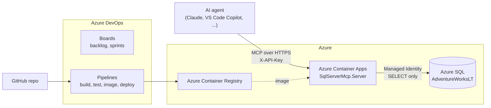

# SqlServerMcp

An MCP (Model Context Protocol) server in C# that gives AI agents **safe, read-only access to SQL Server**.
Built on .NET 10, ASP.NET Core and the official MCP C# SDK, with CI/CD on Azure Pipelines and deployment to Azure Container Apps and Azure SQL.

> Status: work in progress. `list_tables` works; `describe_table` and `query_table` are next.

## Why

Agents are useful on business data, but a model that writes arbitrary SQL against a production database is a risk.
This server lets an agent explore and query data **only through a small set of tools, only on approved tables, and only for reading**.

## Architecture



| Project | Responsibility |
|---|---|
| `SqlServerMcp.Core` | Security rules (table names, allow-list, limits) and services. No database dependency, fully unit-tested. |
| `SqlServerMcp.Infrastructure` | SQL Server access with Microsoft.Data.SqlClient and Dapper. Static, parameterized SQL only. |
| `SqlServerMcp.Server` | ASP.NET Core host: MCP tools over Streamable HTTP, API key, health check. |
| `tests/*` | xUnit + Moq. Core rules in isolation; the HTTP pipeline in memory with WebApplicationFactory. |

## Tools

| Tool | Status | What it does |
|---|---|---|
| `list_tables` | ✅ | Lists the tables the agent may use, with their `MS_Description`. |
| `describe_table` | 🔜 | Columns, types, nullability, primary and foreign keys of an allowed table. |
| `query_table` | 🔜 | Structured filters (column, operator, value) turned into a parameterized `SELECT TOP (n)`. The agent never sends raw SQL. |

## Security model

Defense in depth: each layer assumes the one before it could fail.

1. **Database permissions.** A dedicated user with `SELECT` granted table by table, explicit `DENY` on writes, `EXECUTE` and sensitive tables (`SalesLT.Customer` holds password hashes). On Azure it is the Container App's managed identity, so there is no password to leak. See [`db/create-readonly-user.sql`](db/create-readonly-user.sql).
2. **Table allow-list.** Configured in `SqlMcp:AllowedTables`. Anything not listed is invisible to the agent, even if the database user could read it.
3. **Validated identifiers.** Table and column names from the agent must match `^[A-Za-z_][A-Za-z0-9_]*$` and exist in the allow-list or in the table's metadata before they reach SQL.
4. **Parameters, never concatenation.** Values are always sent as SQL parameters.
5. **Limits.** Row cap (`MaxRows`), command timeout (`CommandTimeoutSeconds`), `ApplicationIntent=ReadOnly`.
6. **Authentication.** The `/mcp` endpoint requires an `X-API-Key` header, compared in constant time. The server will not start outside Development without a key.

Out of scope for the MVP, planned: Microsoft Entra ID (OAuth) as the MCP authorization spec recommends, audit log of every tool call, and handling of prompt-injection content stored in the data itself.

## Run locally

Prerequisites: .NET 10 SDK, Docker.

```bash
cp .env.example .env            # then edit the values
# Download AdventureWorksLT2022.bak from the Microsoft sql-server-samples releases into db/backup/
docker compose up -d sqlserver
# Run db/restore-adventureworkslt.sql, then section A of db/create-readonly-user.sql
docker compose up -d --build mcp-server
curl http://localhost:8080/health
```

Or run from source against your own SQL Server:

```bash
dotnet user-secrets --project src/SqlServerMcp.Server set "ConnectionStrings:Sql" "<connection string>"
dotnet run --project src/SqlServerMcp.Server
```

### Connect an MCP client

With [MCP Inspector](https://github.com/modelcontextprotocol/inspector): `npx @modelcontextprotocol/inspector`, transport *Streamable HTTP*, URL `http://localhost:8080/mcp`, header `X-API-Key`.

In VS Code (`.vscode/mcp.json`):

```json
{
  "servers": {
    "sqlserver-mcp": {
      "type": "http",
      "url": "http://localhost:8080/mcp",
      "headers": { "X-API-Key": "${input:mcpApiKey}" }
    }
  },
  "inputs": [
    { "id": "mcpApiKey", "type": "promptString", "description": "SqlServerMcp API key", "password": true }
  ]
}
```

## Tests

```bash
dotnet test
```

## CI/CD

[`azure-pipelines.yml`](azure-pipelines.yml): build and test on every push and pull request; on `main`, build the Docker image, push it to Azure Container Registry and deploy it to Azure Container Apps.

## License

MIT
